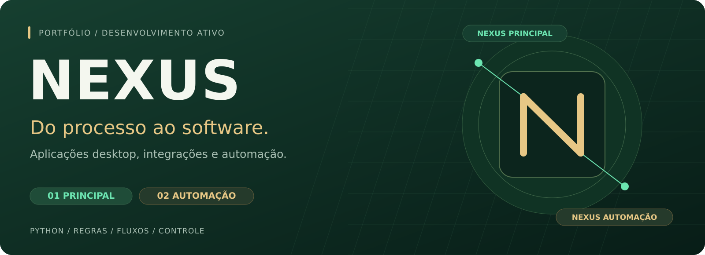
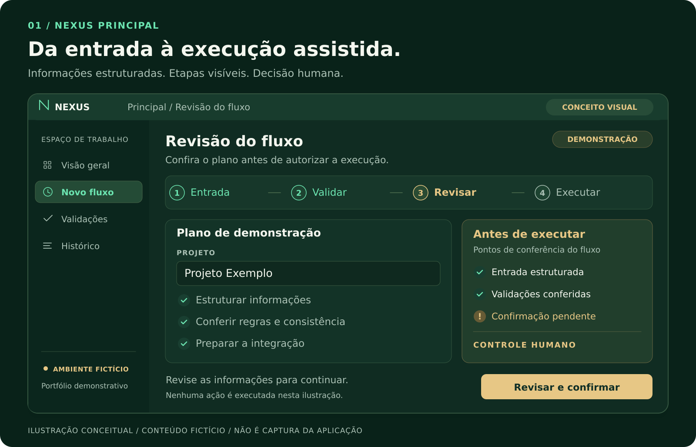
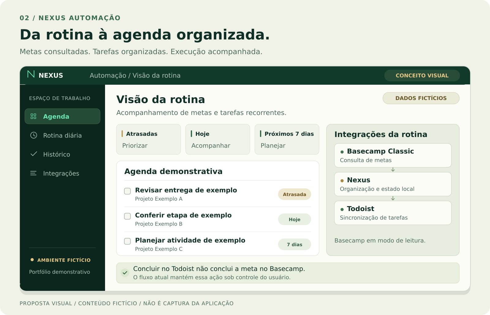

# Nexus

  

**Automação e orquestração de processos com Python.**

Desenvolvo o Nexus para transformar rotinas manuais em fluxos organizados, com validação, acompanhamento e controle sobre a execução. O projeto nasceu de uma necessidade operacional real e reúne duas frentes: **Nexus Principal**, para preparar e conduzir operações, e **Nexus Automação**, para acompanhar metas e organizar tarefas recorrentes.

Este repositório apresenta a arquitetura, as decisões de engenharia e a evolução do projeto. **O desenvolvimento está ativo, com fluxos funcionais e etapas em homologação.**

[Principal](#nexus-principal) · [Automação](#nexus-automação) · [Tecnologias](#tecnologias) · [Evolução](#evolução-do-projeto) · [Sobre mim](#sobre-mim)

[Registro de melhorias e problemas resolvidos →](docs/EVOLUTION.md) · [Proteções de resiliência →](docs/RESILIENCE.md)

> **Sobre as imagens:** o banner e as duas ilustrações foram criados em SVG para este portfólio. As telas são representações conceituais, com conteúdo fictício; não são capturas da aplicação nem reproduções exatas de sua interface atual.

## O problema que estou resolvendo

Uma operação pode começar com um texto, passar por planilhas e consultas a banco, exigir preenchimentos em um sistema web e terminar com verificações manuais. Quando essas etapas ficam desconectadas, o operador precisa reconstruir o contexto a cada passagem e conferir as mesmas informações várias vezes.

O Nexus organiza esse percurso: interpreta a entrada, estrutura os dados, aplica validações e orienta a execução. A proposta é reduzir trabalho repetitivo e inconsistências, mantendo a revisão humana nos pontos que exigem decisão.

## Nexus Principal

**Da entrada textual à execução assistida.**

O Nexus Principal é uma aplicação desktop que conecta interpretação de informações, regras de negócio, planilhas, banco de dados e automação web.

### Recursos desenvolvidos

- **Entrada estruturada:** interpretação e normalização de conceitos textuais, com validação de campos e combinações.
- **Planilhas:** geração e atualização de fichas para revisão das informações.
- **Fluxo operacional:** preparação e condução de etapas relacionadas a projetos, campanhas e iniciativas.
- **Integrações:** consultas e operações com MySQL, além de navegação assistida com Playwright.
- **Controle de execução:** preparação, simulação transacional nos fluxos de banco aplicáveis, confirmação do operador e reconsulta do resultado.
- **Continuidade:** registro de estado, diagnóstico de falhas e evidências para acompanhar a execução.

Uma das evoluções recentes é o **fluxo assistido de seleção**, com validação dos cenários suportados e conferência do estado antes de continuar. As regras específicas e os dados do ambiente de origem ficam fora da apresentação pública.

### Decisões de engenharia

| Decisão | Por que ela existe |
| --- | --- |
| Separar regras, interface e integrações | Permitir evolução sem concentrar toda a lógica na tela. |
| Preparar e validar antes de executar | Identificar inconsistências antes de alterar informações. |
| Simular operações de banco com `ROLLBACK`, quando aplicável | Conferir o plano antes da gravação definitiva. |
| Exigir confirmação nas etapas críticas | Manter o operador no controle das ações de escrita. |
| Interromper diante de um estado inesperado | Evitar que uma divergência seja ignorada durante a automação. |
| Reconsultar e registrar o resultado | Comparar o que foi solicitado com o que foi efetivamente observado. |

[Conheça a arquitetura do Nexus Principal →](docs/ARCHITECTURE.md)

## Nexus Automação

**Da consulta de metas à organização da agenda.**

O Nexus Automação cuida de rotinas recorrentes de acompanhamento. Seu fluxo validado consulta metas no **Basecamp Classic**, organiza o estado local e sincroniza tarefas com o **Todoist**.

### Recursos validados

- Consulta de metas atrasadas, do dia e dos próximos sete dias.
- Organização de uma agenda a partir das informações consultadas.
- Persistência local com SQLite, separada do Nexus Principal.
- Sincronização idempotente com Todoist: repetir a rotina busca atualizar as tarefas correspondentes sem criar duplicatas.
- Execução diária agendada, com registro de resultado e relatório local.

**Limite atual da integração:** o Basecamp é consultado em modo de leitura. Concluir uma tarefa no Todoist não conclui a meta correspondente no Basecamp. A ilustração apresenta uma proposta visual para explicar o fluxo; ela não significa que essa central já esteja implementada nessa forma.

As duas frentes têm responsabilidades distintas: o Principal conduz operações assistidas; a Automação acompanha rotinas recorrentes e organiza tarefas.

## Tecnologias

| Tecnologia | Aplicação no projeto |
| --- | --- |
| **Python** | Regras, processamento e coordenação dos fluxos. |
| **PySide6 / Qt** | Interface desktop do Nexus Principal. |
| **MySQL** | Consultas, validações e operações transacionais do Principal. |
| **Playwright** | Integração do Principal com fluxos em aplicações web. |
| **Pandas / OpenPyXL** | Leitura, geração e atualização de planilhas. |
| **SQLite** | Persistência local da Automação. |
| **Basecamp Classic / Todoist** | Consulta de metas e sincronização de tarefas. |
| **PowerShell / Agendador de Tarefas do Windows** | Inicialização, manutenção e execução de rotinas. |
| **Git** | Versionamento e evolução incremental. |

## Evolução do projeto

O projeto avança por incrementos: implementar um cenário, testar o comportamento, observar o uso e ajustar o fluxo antes de ampliar o escopo.

| Frente | Situação atual | Próximos passos |
| --- | --- | --- |
| **Nexus Principal** | Fluxos funcionais em homologação; proteção contra ações repetidas, troca de contexto e sobrescrita de fichas existentes. | Recuperar preferências e estado local inválidos e investigar pendências de regressão. |
| **Nexus Automação** | Rotina diária e sincronização de tarefas validadas. | Evoluir a central de acompanhamento e avaliar novas ações controladas. |
| **Portfólio público** | Documentação de arquitetura e apresentação visual. | Acrescentar exemplos executáveis com dados fictícios após revisão. |

As duas etapas de 16/10/2026 acrescentaram 55 casos de regressão de resiliência, todos aprovados. A execução completa isolada mais recente terminou com 798 aprovações, mantendo sete falhas e nove erros já documentados. Consulte o [registro de evolução](docs/EVOLUTION.md) para conhecer o escopo e as pendências.

As próximas etapas representam objetivos de desenvolvimento. O repositório público contém documentação e imagens; ainda não inclui uma aplicação demonstrativa instalável.

## O que este projeto demonstra

- **Análise de processos:** entender uma rotina real e convertê-la em etapas de software.
- **Modelagem de regras:** transformar texto e requisitos operacionais em dados e validações.
- **Integração de sistemas:** conectar interface desktop, planilhas, banco e aplicações web.
- **Tratamento de estado e falhas:** conferir pré-condições, registrar progresso e interromper fluxos com diagnóstico.
- **Desenvolvimento incremental:** evoluir a solução a partir de testes, regressões e retorno dos usuários.

## Privacidade e escopo público

O material visual desta apresentação usa somente elementos gráficos e exemplos fictícios. O código operacional completo depende de um contexto privado e não está incluído neste repositório.

Credenciais, arquivos `.env` reais, bancos, dumps, relatórios operacionais, dados pessoais, endereços internos e regras proprietárias ficam fora do escopo público. A apresentação se concentra nos problemas abordados, nas tecnologias e nas decisões de engenharia.

[Política de segurança e publicação →](SECURITY.md)

## Sobre mim

Sou **Rodrigo Oliveira**, desenvolvedor do Nexus. Uso este projeto para aprofundar minha experiência em Python, automação e integração de sistemas, transformando necessidades do dia a dia em software com validação e acompanhamento.

Este portfólio registra o que estou construindo e minha evolução ao longo do desenvolvimento.

[Meu perfil no GitHub →](https://github.com/rodhyy23)
