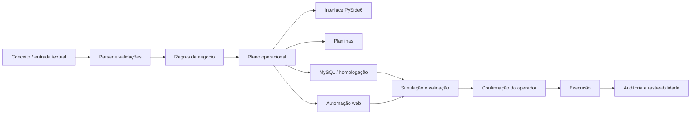

# Nexus

### Automação e orquestração de processos operacionais com Python

> **Status:** desenvolvimento ativo / homologação  
> **Este repositório é uma edição pública de portfólio.** Integrações, dados, credenciais, regras internas e partes do código operacional foram removidos ou anonimizados.

O **Nexus** nasceu de um problema real: um fluxo operacional dependia de várias etapas manuais, validações, consultas, preenchimentos e interação com sistemas diferentes.

A proposta do projeto é transformar esse processo em um fluxo mais **seguro, rastreável, reproduzível e assistido por software**, sem simplesmente automatizar cliques.

## O problema

O processo original exigia que o operador:

- interpretasse informações recebidas em formato textual;
- transformasse essas informações em dados estruturados;
- validasse diversas regras de negócio;
- gerasse e revisasse planilhas;
- consultasse informações em banco de dados;
- interagisse com um sistema web legado;
- acompanhasse estados e pendências;
- repetisse verificações antes de concluir cada operação.

Esse modelo aumentava o esforço manual e tornava o processo mais suscetível a inconsistências.

## A solução

O Nexus centraliza essas etapas em uma aplicação desktop e organiza a execução como um fluxo controlado.



## Principais funcionalidades desenvolvidas

- interpretação e normalização de entradas textuais;
- aplicação de regras de negócio;
- geração e atualização de planilhas;
- interface desktop com **PySide6**;
- integração com **MySQL**;
- automação de navegador com **Playwright**;
- preparação de operações antes da execução;
- simulação de operações com **ROLLBACK** antes da gravação;
- confirmação explícita antes de ações de escrita;
- auditoria e reconsulta após operações;
- persistência de estado para retomada de fluxos;
- validação de consistência entre etapas;
- tratamento de erros com interrupção segura do processo;
- geração de relatórios e evidências locais;
- evolução incremental utilizando **Git** e testes de regressão.

## Segurança por design

Uma das decisões mais importantes do projeto foi evitar automação "cego até dar certo".

O Nexus trabalha com barreiras como:

1. preparação antes da execução;
2. validação das condições esperadas;
3. simulação quando a operação envolve banco de dados;
4. bloqueio diante de estados inesperados ou ambíguos;
5. confirmação humana antes de etapas críticas;
6. reconsulta e auditoria depois da execução;
7. nenhuma credencial incorporada ao código.

O objetivo é que uma falha interrompa o fluxo de forma controlada em vez de gerar alterações silenciosas.

## Tecnologias

`Python` `PySide6` `MySQL` `Playwright` `Pandas` `OpenPyXL` `Git` `PowerShell`

## Arquitetura

O projeto foi dividido em responsabilidades para evitar concentrar regras, interface e integrações em um único módulo.

```text
Nexus
├── application/      # orquestração dos casos de uso
├── core/             # regras, parsing, modelos e validações
├── infra/            # integrações de infraestrutura e banco
├── ui/               # aplicação desktop PySide6
├── automation/       # automação e navegação web
├── audit/            # verificações e comparações
└── tests/            # regressões e contratos do comportamento
```

Mais detalhes em [`docs/ARCHITECTURE.md`](docs/ARCHITECTURE.md).

## Um exemplo da evolução do projeto

Uma das etapas mais recentes implementadas foi um fluxo assistido de seleção de público.

Em vez de executar diretamente, o Nexus:

- interpreta os critérios;
- valida se o cenário é suportado;
- confere metadados e estado atual;
- bloqueia padrões desconhecidos ou condições consideradas inseguras;
- abre o fluxo oficial apenas quando a preparação está válida;
- exige confirmações distintas para preparação e execução;
- reconsulta o resultado e registra apenas informações necessárias ao acompanhamento.

Essa abordagem representa bem a filosofia do projeto: **automatizar sem remover controle e rastreabilidade**.

## O que este projeto demonstra

Mais do que uma tecnologia específica, o Nexus representa minha evolução em:

- transformar um problema operacional em software;
- entender e modelar regras de negócio;
- dividir um sistema em módulos e responsabilidades;
- trabalhar com aplicações que possuem estado;
- integrar banco, interface e automação web;
- pensar em falhas e segurança antes da execução;
- validar uma solução em um fluxo real e evoluí-la a partir dos testes.

## Status atual

🟡 **Em estágio avançado de desenvolvimento e homologação.**

Os principais fluxos já são funcionais. O projeto continua recebendo novas regras, melhorias de navegação, integrações e automações.

## Sobre o código público

O Nexus foi criado a partir de uma necessidade de ambiente profissional. Por isso, este repositório não é um espelho do ambiente operacional.

Foram deliberadamente excluídos:

- credenciais e arquivos `.env` reais;
- endereços e URLs internos;
- nomes e dados de pessoas;
- dados operacionais;
- bancos locais e dumps;
- identificadores internos;
- regras específicas que possam expor processos privados;
- código cujo contexto depende diretamente de sistemas internos.

A intenção deste repositório é documentar a **engenharia, arquitetura, decisões e evolução técnica** do projeto de forma segura.

Veja também [`SECURITY.md`](SECURITY.md).

---

Desenvolvido por **Rodrigo Oliveira** como parte da minha evolução em desenvolvimento de software, automação e engenharia de sistemas.
