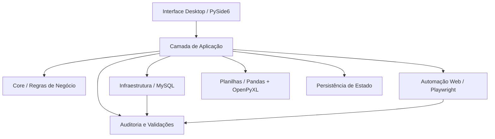

# Arquitetura do Nexus — visão pública

Este documento descreve a arquitetura do Nexus de forma sanitizada para portfólio.

Nomes de sistemas internos, tabelas, endpoints, credenciais, identificadores e regras específicas do ambiente operacional foram removidos ou generalizados.

## Visão geral

O Nexus é uma aplicação desktop em Python que coordena diferentes etapas de um processo operacional.

A arquitetura foi evoluindo para separar quatro preocupações principais:

1. **interpretação e regras de negócio**;
2. **orquestração dos casos de uso**;
3. **integrações externas**;
4. **interface e acompanhamento do operador**.

## Core

A camada de domínio concentra parsing, normalização, modelos e regras.

A intenção é manter decisões de negócio fora da interface e fora dos detalhes de banco ou navegador.

Responsabilidades típicas:

- interpretar entradas textuais;
- normalizar valores;
- identificar tipos de operação;
- validar combinações permitidas;
- construir planos de execução;
- detectar inconsistências antes das integrações.

## Camada de aplicação

A camada de aplicação coordena os fluxos sem concentrar a implementação das integrações.

Ela é responsável por tarefas como:

- preparar uma operação;
- verificar pré-condições;
- recuperar e persistir o estado;
- chamar serviços de banco ou navegador;
- comparar o estado esperado com o estado observado;
- decidir se o fluxo pode continuar ou deve ser bloqueado.

## Interface desktop

A interface oficial utiliza **PySide6**.

A UI funciona como uma camada de orientação do operador e não apenas como um conjunto de botões. Ela apresenta etapas, bloqueios, resultados de validação, pendências e confirmações necessárias antes de ações críticas.

## Integração com banco

O projeto possui integração com **MySQL**.

Uma decisão arquitetural importante foi separar operações de leitura, preparação e escrita.

Nos fluxos que envolvem alteração de dados, o Nexus trabalha com práticas como:

- validação de parâmetros;
- simulação transacional;
- `ROLLBACK` antes da gravação definitiva;
- confirmação explícita do operador;
- reconsulta após execução;
- interrupção diante de divergências.

## Automação web

A integração com aplicações web utiliza **Playwright**.

A automação é tratada como uma integração sujeita a falhas e mudanças de estado, não como uma sequência irrestrita de cliques.

Por isso o fluxo possui verificações intermediárias, seletores controlados e bloqueios quando a aplicação externa não apresenta o estado esperado.

## Planilhas

**Pandas** e **OpenPyXL** são utilizados para leitura, geração e atualização de informações estruturadas em planilhas.

Esse componente permite que o projeto integre etapas que ainda dependem de arquivos Excel sem acoplar toda a lógica do Nexus ao formato da planilha.

## Estado e retomada

Operações podem possuir múltiplas etapas e não devem depender apenas do estado visual atual da interface.

O Nexus registra estado suficiente para:

- identificar a operação;
- verificar o ponto em que ela foi interrompida;
- evitar repetir etapas críticas;
- invalidar preparações quando a entrada original muda;
- registrar eventos relevantes para auditoria.

## Filosofia de falha segura

O projeto prioriza **fail closed** nos pontos críticos.

Quando existe divergência entre o que o Nexus esperava e o estado encontrado no sistema externo, a preferência é interromper e apresentar diagnóstico em vez de adaptar silenciosamente a operação.

Essa decisão foi adotada porque o software interage com processos reais e uma execução incorreta pode ser mais prejudicial do que uma execução interrompida.

## Limite desta documentação

A versão operacional contém regras e integrações específicas do ambiente onde o projeto foi desenvolvido.

Esses elementos não fazem parte deste repositório público. O objetivo aqui é demonstrar a arquitetura, as decisões de engenharia e a evolução do projeto sem expor informações privadas ou proprietárias.
